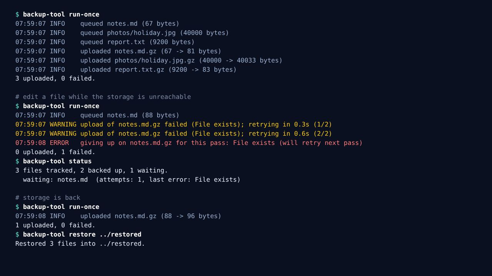

<h1 align="center">Cloud Backup Tool</h1>

<p align="center"><b>Watch a folder, compress what changed, upload with retries, restore with checksums.</b></p>

<p align="center">
     
</p>

<p align="center">
  
</p>

Watches a folder, compresses files that are new or changed, and uploads them on a schedule. Failed uploads are retried, nothing is lost quietly, and `restore` brings files back with a checksum check.

No paid services and no API keys are involved. The default backend is any folder, and the optional S3 backend works with open-source servers such as [MinIO](https://github.com/minio/minio) using credentials you create yourself.

## Install

Needs Python 3.11 or newer. The core has no dependencies.

```bash
pip install .            # folder backend only
pip install ".[s3]"      # adds boto3 for S3-compatible storage
```

## Use

```bash
cp backup.example.toml backup.toml    # then edit it
backup-tool run-once                  # one pass
backup-tool watch                     # a pass every interval_seconds, until Ctrl+C
backup-tool status                    # what is backed up and what is waiting
backup-tool restore ~/restored        # everything, with checksum verification
backup-tool restore ~/restored --only docs/report.txt
```

Exit codes: `0` success, `1` some uploads or restores failed, `2` a problem in the config.

## How it works

1. **Scan.** Files are compared by size and modification time; only when those differ is the SHA-256 computed, so touching a file without changing it doesn't re-upload it. Files modified within `settle_seconds` are left for the next pass, and symlinks are skipped so a link can't pull in files from outside the source folder.
2. **Compress.** Each file is gzipped on its own into a temporary file. Output is deterministic, so identical content gives identical bytes.
3. **Upload with retries.** A failed upload is retried with exponential backoff (doubling from `backoff_base`, capped at `backoff_cap`, with jitter). If it still fails, the file stays queued in `state.json` with the last error, and the next pass tries again. State is written after every file, atomically.
4. **Log.** Everything goes to the console and to `backup.log` in the state folder, rotated at 1 MB.
5. **Restore.** Each object carries the SHA-256 of the original file. Restore decompresses, verifies it, and refuses to write a file whose checksum doesn't match or whose path would land outside the restore folder.

## Limits

- Each pass overwrites the remote copy with the latest version. It keeps no history of older versions.
- Watching is by polling, not file-system events, so changes show up on the next interval.
- Very small files can end up larger after gzip. The tool doesn't skip them.
- Files deleted from the source stay in the backup.
- `status` reports what this tool uploaded. It doesn't re-check the storage, so files deleted from the storage by something else aren't noticed.

## Tests

```bash
pip install -e ".[dev]"
pytest
```

The suite covers change detection, retries and backoff, restore round trips, corrupted and malicious objects, the CLI, and the S3 backend against a mocked S3 server (moto).

## Project layout

```text
backup_tool/scanner.py    finds new and changed files (size, mtime, then SHA-256)
backup_tool/engine.py     gzip, upload, retries with backoff, restore with verification
backup_tool/backends.py   folder backend and the optional S3-compatible backend
backup_tool/state.py      state.json, written atomically
backup_tool/config.py     backup.toml loading and validation
backup_tool/cli.py        run-once, watch, status, restore
tests/                    engine, config, CLI and S3 (mocked with moto)
```

## Licence

MIT

Part of my [portfolio](https://kcarnage1.github.io/My-Persona-Portfolio/).
